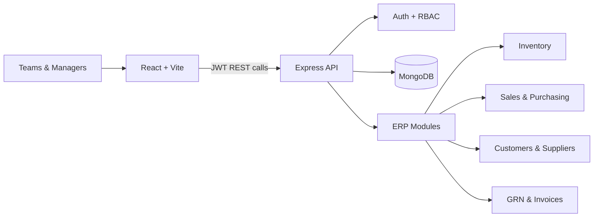

<div align="center">

# ✦ Apex Enterprise ERP

### One workspace for every operation that keeps your business moving.

<p>
  <strong>A modern, role-aware MERN ERP for inventory, sales, procurement, customers, suppliers, GRNs, and billing.</strong>
</p>

<p>
  <a href="#-why-apex-erp">Why Apex?</a> ·
  <a href="#-product-tour">Product tour</a> ·
  <a href="#-quick-start">Quick start</a> ·
  <a href="#-api-snapshot">API snapshot</a> ·
  <a href="#-demo-access">Demo access</a>
</p>

<br />

[](https://react.dev/)
[](https://vite.dev/)
[](https://nodejs.org/)
[](https://expressjs.com/)
[](https://www.mongodb.com/)
[](https://jwt.io/)

</div>

<br />

> **Apex ERP turns scattered business activity into a clear operating picture.**
> Give every team the right view, the right permissions, and the right action at the right time.

---

## ✨ Why Apex ERP?

| Signal | What Apex delivers |
| :--- | :--- |
| **Clarity** | Executive KPIs, order status, revenue trends, and inventory health in one dashboard |
| **Control** | JWT authentication, protected routes, and role-based permissions across every module |
| **Continuity** | Connect the complete flow from purchase order → GRN → stock → sales order → invoice |
| **Speed** | Quick demo accounts, searchable tables, reusable forms, and one-click PDF exports |

## 🧭 Product Tour

### 📊 Command center

See revenue, sales, purchases, pending restocks, and operational trends without jumping between tools.

### 📦 Inventory that stays current

Manage SKUs, stock levels, categories, reorder points, and low-stock alerts with automated status badges.

### 🤝 Relationships in one place

Keep customer and supplier profiles, contacts, payment terms, credit balances, and tax information organized.

### 🔄 Orders with a visible lifecycle

Build multi-item sales and purchase orders with automatic totals, tax, discounts, and status transitions:

`Pending` → `Approved` → `Shipped` → `Delivered` → `Cancelled`

### 🏭 Receiving that updates stock

Create Goods Receipt Notes, record inspected/accepted/rejected quantities, capture batch details, and automatically increment inventory.

### 🧾 Billing ready to share

Generate invoices from sales orders, track `Unpaid` / `Paid` / `Overdue` states, and export polished PDFs directly from the browser.

### 🛡️ Admin governance

Manage users, roles, active status, permissions, and the built-in OpenAPI documentation explorer.

---

## 🏗️ How It Fits Together



## 🧰 Technology Stack

| Area | Tools |
| :--- | :--- |
| **Experience** | React 18, React Router 6, React Bootstrap, Bootstrap Icons, Lucide React |
| **Frontend runtime** | Vite, Axios, Context API, React Toastify |
| **Analytics & documents** | Recharts, jsPDF, jspdf-autotable |
| **Backend runtime** | Node.js 20+, Express 4, ES Modules |
| **Data layer** | MongoDB, Mongoose 8 |
| **Security** | JWT, bcryptjs, protected routes, role authorization |

## 📁 Project Map

```text
erp-management-system/
├── backend/
│   ├── src/
│   │   ├── config/          # Database connection
│   │   ├── controllers/     # Business logic
│   │   ├── middleware/      # Auth, roles, errors
│   │   ├── models/          # MongoDB schemas
│   │   ├── routes/          # REST endpoints
│   │   ├── seed/            # Demo data
│   │   └── server.js        # API entrypoint
│   ├── .env.example
│   └── package.json
└── frontend/
    ├── src/
    │   ├── api/             # Axios client and services
    │   ├── components/      # Shared UI
    │   ├── context/         # Auth state
    │   ├── pages/           # ERP screens
    │   └── styles/          # Design system
    ├── vite.config.js
    └── package.json
```

---

## ⚡ Quick Start

### Prerequisites

- Node.js **18+** (20+ recommended)
- MongoDB local instance or MongoDB Atlas
- npm

### 1. Configure the backend

```bash
cd backend
npm install
cp .env.example .env
```

Update `.env` with your MongoDB connection string and secrets:

```env
PORT=5001
NODE_ENV=development
MONGO_URI=mongodb://127.0.0.1:27017/erp_management
JWT_SECRET=replace_with_a_secure_secret
JWT_EXPIRE=7d
CLIENT_URL=http://localhost:5173
```

Seed demo data and start the API:

```bash
npm run seed
npm run dev
```

The backend runs at **http://localhost:5001**.

### 2. Launch the frontend

Open a second terminal:

```bash
cd frontend
npm install
npm run dev
```

Open **http://localhost:5173**.

> The Vite development proxy forwards `/api` requests to the backend. Keep both terminals running while using the app.

## 🔑 Demo Access

All seeded demo accounts use the password `password123`.

| Role | Email | Access highlights |
| :--- | :--- | :--- |
| 👑 **Admin** | `admin@erp.com` | Full universal access |
| 💼 **Sales** | `sales@erp.com` | Products, customers, sales orders, invoices |
| 📦 **Purchase** | `purchase@erp.com` | Suppliers, purchase orders, GRN |
| 🏭 **Inventory** | `inventory@erp.com` | Products, suppliers, GRN, stock alerts |
| 💵 **Finance** | `finance@erp.com` | Customers, sales orders, invoices, billing |

You can also use the quick-fill account buttons on the login screen.

---

## 📡 API Snapshot

| Domain | Method | Endpoint | Access |
| :--- | :---: | :--- | :--- |
| Auth | `POST` | `/api/auth/register` | Public |
| Auth | `POST` | `/api/auth/login` | Public |
| Auth | `GET` | `/api/auth/me` | Private |
| Products | `GET` | `/api/products` | Private |
| Products | `POST` | `/api/products` | Admin, Inventory |
| Customers | `GET` / `POST` | `/api/customers` | Private / Admin, Sales |
| Suppliers | `GET` / `POST` | `/api/suppliers` | Private / Admin, Purchase |
| Sales orders | `GET` / `POST` | `/api/sales-orders` | Private / Admin, Sales |
| Purchase orders | `GET` / `POST` | `/api/purchase-orders` | Private / Admin, Purchase |
| GRN | `POST` | `/api/grn` | Admin, Inventory |
| Invoices | `GET` / `POST` | `/api/invoices` | Private / Admin, Sales, Finance |
| Dashboard | `GET` | `/api/dashboard/stats` | Private |
| API docs | `GET` | `/api/docs` | Public |

Health check:

```bash
curl http://localhost:5001/api/health
```

## 🔐 Security Notes

- Passwords are hashed with `bcryptjs`.
- JWT secrets and database credentials belong in `.env`, never in source control.
- Frontend protected routes are paired with backend authentication and role middleware.
- Replace every demo secret before deploying to a real environment.

## 🛠️ Useful Commands

| Command | Purpose |
| :--- | :--- |
| `cd backend && npm run dev` | Start the API with watch mode |
| `cd backend && npm run seed` | Reset and seed demonstration data |
| `cd frontend && npm run dev` | Start the Vite frontend |
| `cd frontend && npm run build` | Create a production frontend build |

## 📄 License

Built for enterprise demonstration and learning. Customize, extend, and adapt it for your own business workflows.

<div align="center">

### Built to make operations feel simpler.

**Apex Enterprise ERP** · React + Express + MongoDB

</div>
