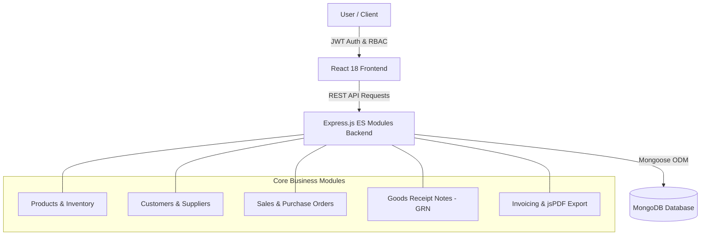

<div align="center">

# 🏢 Apex Enterprise ERP Management System
### *Modern, Full-Stack MERN Enterprise Resource Planning Web Application*

[](https://react.dev/)
[](https://react-bootstrap.github.io/)
[-339933?style=for-the-badge&logo=node.js&logoColor=white)](https://nodejs.org/)
[](https://expressjs.com/)
[](https://www.mongodb.com/)
[](https://jwt.io/)

<p align="center">
  <b>A comprehensive ERP solution designed for mid-sized organizations to streamline supply chain, inventory tracking, customer relationships, purchase/sales lifecycles, goods receipt inspection (GRN), and PDF invoice generation.</b>
</p>

[Key Features](#-key-features) • [Tech Stack](#-technology-stack) • [Live Screenshots](#-application-modules--walkthrough) • [Getting Started](#-getting-started) • [API Reference](#-api-endpoints-reference) • [Demo Credentials](#-pre-configured-demo-accounts)

---

</div>

## 🌟 Executive Overview

**Apex ERP** connects core business operations into a unified, role-governed platform. Built with modern web standards, it provides executives, sales representatives, procurement teams, and warehouse managers with the real-time data they need to make informed decisions.



---

## 🚀 Key Features

### 🔐 1. Authentication & Role-Based Access Control (RBAC)
- **Token-Based Auth**: Secure JWT authentication with configurable expiration and session storage.
- **Granular Permissions**: Role-specific navigation and action guards for `admin`, `sales`, `purchase`, `inventory`, and `finance`.
- **1-Click Quick Demo Login**: Instant credential fill buttons on the login screen for testing each role.

### 📊 2. Executive Analytics Dashboard
- **Real-Time KPIs**: Track Total Revenue, Sales Volumes, Purchase Outlays, and Pending Restocks.
- **Interactive Charts**:
  - **Financial Comparison**: Monthly Sales vs Purchases trend area chart powered by **Recharts**.
  - **Status Distribution**: Donut charts visualizing active order lifecycles.
- **Inventory Health Feed**: Automatic tracking of low-stock items with reorder point warnings.

### 📦 3. Product & Inventory Management
- **Full CRUD Support**: Add, update, search, and delete products with SKU, title, category, and unit metrics.
- **Automated Stock Status**: Dynamic badges for `In Stock`, `Low Stock`, and `Out of Stock`.
- **Customizable Reorder Point**: Automatic triggers alerting managers before inventory depletes.

### 🤝 4. Customer & Supplier Directories
- Comprehensive partner contact books storing phone numbers, emails, physical addresses, tax/VAT numbers, and credit balances.
- Configurable **payment terms** (`Net 15`, `Net 30`, `Due on Receipt`, etc.).

### 🛒 5. Sales & Purchase Order Lifecycles
- **Interactive Order Builder**: Dynamic line item creator with automated quantity × unit price calculations.
- **Automatic Financial Calculations**: Subtotal, configurable tax rate (10%), discount adjustments, and grand total.
- **Order Stages**: Transition orders through `Pending` ➔ `Approved` ➔ `Shipped` ➔ `Delivered` ➔ `Cancelled`.

### 🏭 6. Goods Receipt Notes (GRN) & Automated Restock
- **Purchase Order Linkage**: Generates GRNs with pre-populated order items.
- **Warehouse Inspection**: Record inspected, accepted, and rejected quantities alongside batch/lot numbers.
- **Automated Inventory Stock Increment**: Accepting a GRN automatically increases product quantities in MongoDB!

### 🧾 7. Invoicing & Client-Side PDF Export
- Generate professional invoices linked to Sales Orders in 1-click.
- **PDF Export Engine**: Built-in **jsPDF + AutoTable** integration to download branded PDF invoices locally.
- Real-time payment tracking (`Unpaid` ➔ `Paid` ➔ `Overdue`).

### 🛡️ 8. Admin User Management & API Explorer
- Control user permissions, update employee roles, and activate/deactivate accounts.
- Built-in **OpenAPI / Postman Explorer** to view endpoints and export JSON specs.

---

## 🛠️ Technology Stack

| Layer | Technologies Used |
| :--- | :--- |
| **Frontend Framework** | **React 18**, **Vite** |
| **UI & Styling** | **React Bootstrap 5**, **Bootstrap Icons**, **Lucide React** |
| **State & Routing** | **Context API**, **React Router v6** |
| **HTTP Client & Notifications** | **Axios** (with JWT Bearer interceptors), **React-Toastify** |
| **Data Visualization & PDF** | **Recharts**, **jsPDF**, **jspdf-autotable** |
| **Backend Engine** | **Node.js (v20+)**, **Express.js (ES Modules - `"type": "module"`)** |
| **Database & ODM** | **MongoDB Atlas / Local**, **Mongoose** |
| **Security & Validation** | **JSON Web Tokens (JWT)**, **Bcrypt.js**, **Express-Validator** |

---

## 📁 Repository Structure

```
erp-management-system/
├── backend/                        # Node.js + Express.js API Server
│   ├── src/
│   │   ├── config/                 # MongoDB database connection
│   │   ├── controllers/            # Controller business logic
│   │   ├── middleware/             # Auth, role authorization, error handling
│   │   ├── models/                 # Mongoose schemas (User, Product, Order, GRN, etc.)
│   │   ├── routes/                 # Express API routes
│   │   ├── seed/                   # Database seeder with sample data
│   │   └── server.js               # Express application entrypoint
│   ├── .env.example                # Sample environment variables
│   └── package.json                # Backend dependencies and scripts
│
└── frontend/                       # React 18 + React Bootstrap Web Application
    ├── src/
    │   ├── api/                    # Axios client instance & service modules
    │   ├── components/             # Reusable UI components & layouts
    │   ├── context/                # Global AuthContext & user role state
    │   ├── pages/                  # Application views (Dashboard, Orders, Invoices, etc.)
    │   ├── styles/                 # Custom CSS design system
    │   ├── App.jsx                 # Routing configuration
    │   └── main.jsx                # React DOM entrypoint
    ├── vite.config.js              # Vite server & proxy configuration
    └── package.json                # Frontend dependencies
```

---

## ⚡ Getting Started

### Prerequisites
- **Node.js** (v18 or higher)
- **MongoDB** (Local instance or MongoDB Atlas Connection String)
- **npm** or **yarn**

---

### 1️⃣ Clone the Repository
```bash
git clone <YOUR_REPOSITORY_URL>
cd erp-management-system
```

---

### 2️⃣ Backend Setup
1. Navigate to the `backend` folder:
   ```bash
   cd backend
   ```
2. Install dependencies:
   ```bash
   npm install
   ```
3. Configure `.env` file:
   ```env
   PORT=5001
   NODE_ENV=development
   MONGO_URI=mongodb://127.0.0.1:27017/erp_management
   JWT_SECRET=your_super_secret_jwt_key_here
   JWT_EXPIRE=7d
   CLIENT_URL=http://localhost:5173
   ```
4. **Seed Sample Demo Data** (Creates demo users, orders, products, and invoices):
   ```bash
   npm run seed
   ```
5. Start the backend development server:
   ```bash
   npm run dev
   ```
   *The API will be available at `http://localhost:5001`.*

---

### 3️⃣ Frontend Setup
1. Open a new terminal and navigate to `frontend`:
   ```bash
   cd frontend
   ```
2. Install dependencies:
   ```bash
   npm install
   ```
3. Start the Vite development server:
   ```bash
   npm run dev
   ```
4. Open **`http://localhost:5173`** in your browser.

---

## 🔑 Pre-Configured Demo Accounts

For quick testing and grading, pre-seeded accounts with password `password123` are available:

| Role | Email | Password | Allowed Modules |
| :--- | :--- | :--- | :--- |
| **👑 Admin** | `admin@erp.com` | `password123` | **Full Universal Access** |
| **💼 Sales** | `sales@erp.com` | `password123` | Dashboard, Products, Customers, Sales Orders, Invoices |
| **📦 Purchase** | `purchase@erp.com` | `password123` | Dashboard, Products, Suppliers, Purchase Orders, GRN |
| **🏭 Inventory** | `inventory@erp.com` | `password123` | Dashboard, Products, Suppliers, GRN, Stock Alerts |
| **💵 Finance** | `finance@erp.com` | `password123` | Dashboard, Customers, Sales Orders, Invoices & Billing |

*(Tip: You can also click the quick-fill buttons directly on the Login page!)*

---

## 📡 API Endpoints Reference

| Module | Method | Endpoint | Description | Access |
| :--- | :---: | :--- | :--- | :--- |
| **Auth** | `POST` | `/api/auth/register` | Register new employee | Public |
| **Auth** | `POST` | `/api/auth/login` | Authenticate user & get JWT | Public |
| **Auth** | `GET` | `/api/auth/me` | Fetch active profile | Private |
| **Products** | `GET` | `/api/products` | List products (`?search=`, `?category=`) | Private |
| **Products** | `POST` | `/api/products` | Create a new product | Admin, Inventory |
| **Products** | `PUT` | `/api/products/:id` | Update product details | Admin, Inventory |
| **Products** | `DELETE`| `/api/products/:id` | Remove a product | Admin |
| **Customers** | `GET` | `/api/customers` | List all customers | Private |
| **Customers** | `POST` | `/api/customers` | Add new customer profile | Admin, Sales |
| **Suppliers** | `GET` | `/api/suppliers` | List all suppliers | Private |
| **Suppliers** | `POST` | `/api/suppliers` | Add new vendor profile | Admin, Purchase |
| **Sales Orders**| `GET` | `/api/sales-orders` | List sales orders with status | Private |
| **Sales Orders**| `POST` | `/api/sales-orders` | Create multi-item sales order | Admin, Sales |
| **Sales Orders**| `PUT` | `/api/sales-orders/:id` | Update order status | Admin, Sales |
| **Purchase** | `GET` | `/api/purchase-orders`| List procurement orders | Private |
| **Purchase** | `POST` | `/api/purchase-orders`| Create new purchase order | Admin, Purchase |
| **GRN** | `POST` | `/api/grn` | Create GRN & increment stock | Admin, Inventory |
| **Invoices** | `GET` | `/api/invoices` | List billing invoices | Private |
| **Invoices** | `POST` | `/api/invoices` | Issue invoice from sales order | Admin, Sales, Finance |
| **Dashboard** | `GET` | `/api/dashboard/stats`| Get aggregated KPI stats & charts | Private |
| **Users** | `GET` | `/api/users` | List all users (Admin only) | Admin |
| **Docs** | `GET` | `/api/docs` | OpenAPI 3.0 JSON Specification | Public |

---

## 🔒 Security Best Practices
- **Password Hashing**: Industry standard `bcryptjs` with salt factor 10.
- **Route Guards**: Client-side protected route wrappers combined with backend role-verification middleware.
- **Environment Isolation**: Database credentials, MongoDB Atlas strings, and JWT secrets are strictly managed in `.env`.

---

## 📜 License
This project is developed for enterprise demonstration purposes. You are free to customize and expand it for production workflows.
